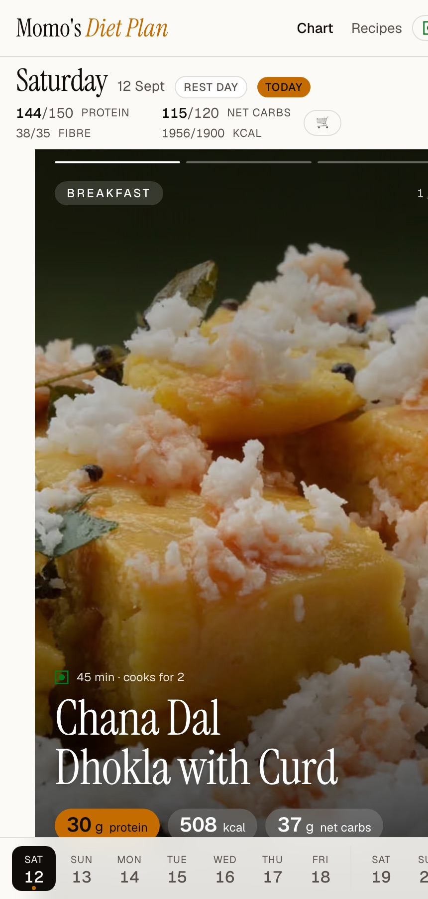

# Momo's Diet Plan

A static, content-driven 14-day meal plan: high protein, carb-cycled by training day, fibre-forward, dinners lightest. Every number on the site is computed from a per-100 g ingredient table, never typed by hand.

**Live:** https://nkb134.github.io/momos-diet-plan/



The chart is a reel: swipe up through the day's meals, swipe right on a meal for its key ingredients and macros, once more for a short video of a similar method. The bar at the bottom switches days. Every recipe has its own page with a serving scaler, checkable ingredients, and a cook mode that keeps the screen awake.

## Stack

Astro 7 with content collections and Zod, Tailwind 4 (CSS-first tokens), TypeScript strict, Node scripts for the macro engine and validator, GitHub Actions to GitHub Pages. No backend, no runtime API calls. Works offline for pages you have visited.

## Local development

```bash
npm install
npm run dev          # http://localhost:4321/momos-diet-plan/
npm run build        # runs the validator first, then builds to dist/
npm run validate     # the 14 plan rules with a per-day table
npm run check-reference  # engine output vs 14-day-diet-plan.md
npm run lighthouse   # mobile Lighthouse on chart, recipe, library
```

## How to add a recipe

Three paths, same result: a markdown file in `src/content/recipes/`.

1. **Drop a file.** Copy any existing recipe, change the frontmatter, save as `src/content/recipes/<slug>.md`, put a photo at `src/assets/recipes/<slug>.jpg`, run `npm run compute-macros`, push. The recipe page, library, search index, and filters all derive from the collection at build time.
2. **`npm run new-recipe`.** Answers the fields in order and writes the file. Then `npm run compute-macros`.
3. **GitHub issue.** Open a "New recipe" issue from the template. A workflow writes the file, computes macros, validates, and opens a pull request with the preview link.

Ingredient quantities in frontmatter are **per serving**; `serves` says how many people the recipe page cooks for (veg dishes 2, non-veg add-ons 1). Ingredient keys must exist in `src/data/ingredients.yaml`; the build fails otherwise. Macros are generated by `scripts/compute-macros.mjs`, so never edit the `macros` block by hand.

To put a recipe on the plan, reference its slug in `src/content/plan/week-NN.yaml` under a day's slot. Every slot needs a `veg` recipe; `nonVegAddOn` is optional and always an addition. `portion` scales the whole recipe and `anchorGrams` then overrides the anchor ingredient's grams for that day.

## Nutrition rules

All thresholds live in [`src/nutrition.config.ts`](src/nutrition.config.ts) with a comment per value. `scripts/validate-plan.mjs` runs before every build and in CI, and prints a per-day table of actuals against targets when something fails. Figures on the site are estimates: cooking losses, portion drift, and ingredient variation are real.

Every ingredient row carries a `source` traced to IFCT 2017 or USDA FoodData Central. The audit in [`src/data/ingredient-audit.json`](src/data/ingredient-audit.json) records the primary value next to the table value; 45 of 77 rows differ from the primary by more than 15% on at least one nutrient, mostly IFCT-versus-USDA disagreements on vegetables and pulse fibre. Values were left as they are because the plan's day totals depend on them; tune a row, run `npm run compute-macros && npm run validate`, and the validator will tell you which days move.

## Quality

Mobile Lighthouse, run with `npm run lighthouse` against the production build on 12 September 2026:

| Page | Performance | Accessibility | Best practices | SEO |
|---|---:|---:|---:|---:|
| Chart | 96 | 100 | 100 | 100 |
| Recipe | 99 | 100 | 100 | 100 |
| Library | 99 | 100 | 100 | 100 |

The chart, recipe, and library pages work with JavaScript disabled (native scroll-snap and `<details>`-free markup), are keyboard operable (arrow keys move through the reel), and respect `prefers-reduced-motion`.

## Images and videos

Photos come from Wikimedia Commons under free licences and are converted to AVIF and WebP at build time; a recipe with no photo gets a deterministic SVG card instead of a broken image. Videos are YouTube Shorts loaded only when tapped, through the privacy-friendly no-cookie domain.

See [CONTRIBUTING.md](CONTRIBUTING.md) for the recipe schema field by field.
